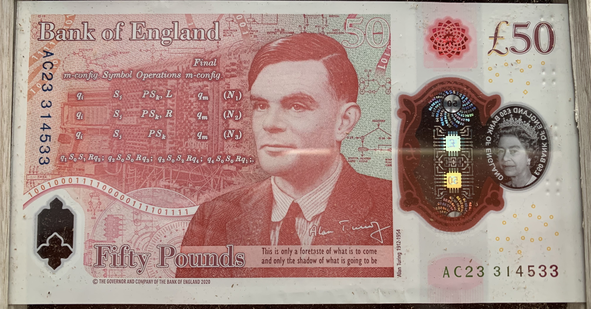

::: {.grid}

::: {.g-col-12 .g-col-sm-4}

```{=html}
<style>
.grid-item {
  display: flex;
  width: 75%;
  height: auto;
  margin: 0 auto 4rem;
}
</style>
<div class="grid" style="--bs-columns: 5; row-gap: 0;">
  <div class="g-col-1 g-col-sm-0"></div>
  <div class="g-col-3 g-col-sm-5">
    <picture>
      <source media="(max-width: 576px)" srcset="">
      <source media="(min-width: 576px)" srcset="">
      }}" alt="">
    </picture>
  </div>
  <div class="g-col-1 g-col-sm-0"></div>
</div>
```

:::

::: {.g-col-12 .g-col-sm-8}

Dr Arthur Turrell is an economic data scientist at [Google](https://ai.google/economy/). He is a former [No10 Innovation Fellow](https://fellows.ai.gov.uk), Research and Data Manager at the Bank of England, and Deputy Director and Acting Director of the ONS Data Science Campus. He started his career in physics and remains a visitor to the plasma physics group at Imperial College London. Today, his [research](research/index.qmd) covers the intersection between economics and data science—including AI.

As well as research, Arthur is passionate about making science and economics more accessible — mostly because scientists shouldn't be allowed to have all the fun. You can find more information about his outreach activities and links to some of his writing on the [public talks and media](media/index.qmd) page, while information on *The Star Builders*, his popular science book on nuclear fusion, can be found [here](thestarbuilders/thestarbuilders.qmd).

While previously at the Bank of England, Arthur was lucky enough to be asked to help to design a new bank note featuring Alan Turing. Arthur chose the mathematical elements from Turing's work to feature on the note. If you're lucky enough to have a £50 note in your wallet or purse, you can have a look at how it turned out for yourself!

```{=html}

```

:::

:::

## Latest posts

:::{#latest-posts}
:::
